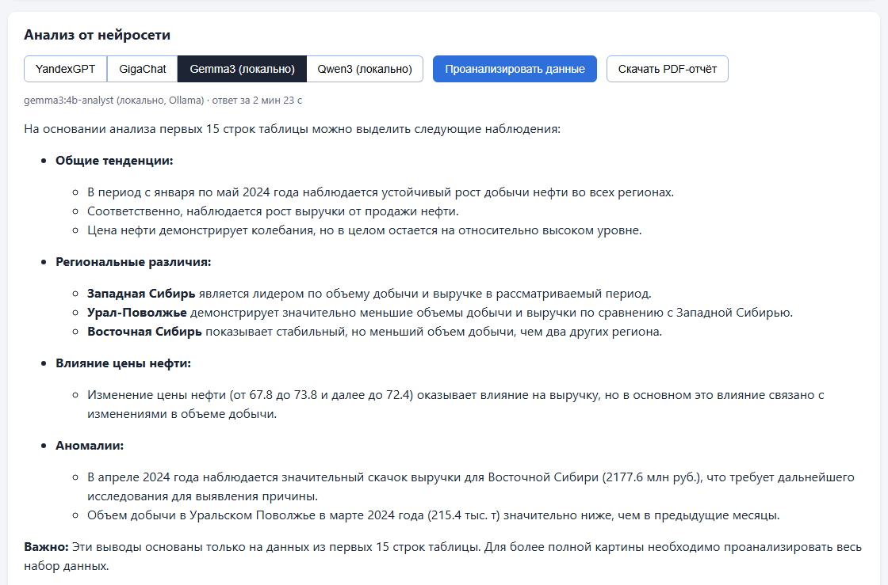
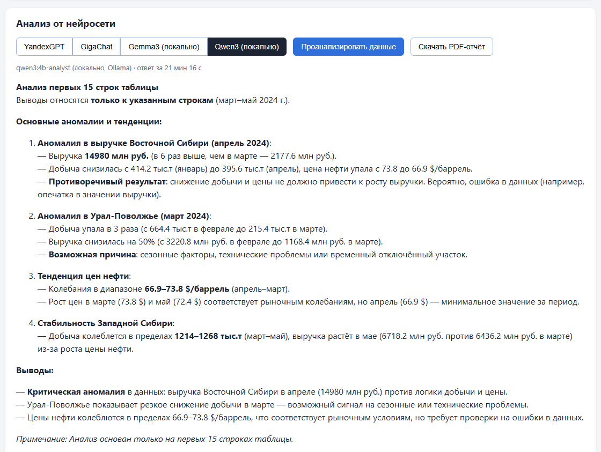

# ИИ-аналитик таблиц — CSV / XLSX / PDF → график → выводы нейросети → PDF-отчёт

Веб-приложение: загружаете таблицу (CSV, Excel или PDF с таблицей), видите её в браузере и
график по любой числовой колонке, нажимаете «Проанализировать» — нейросеть на выбор (российские облачные **YandexGPT** и
**GigaChat** или **две локальные модели в Ollama** — Gemma3 и Qwen3 — прямо на вашем компьютере) находит тенденции и аномалии, а отчёт с
таблицей, статистикой и выводами скачивается в PDF.

*Web app: upload a table (CSV / XLSX / PDF), see it with a chart, get an AI analysis from
YandexGPT, GigaChat or local Gemma3 / Qwen3 via Ollama, download a PDF report. React + TypeScript (Vite) · Flask · pandas ·
pdfplumber · reportlab.*


| График: выброс виден сразу | Выводы YandexGPT |
|---|---|
|  |  |

Локальные модели в Ollama — тот же анализ без интернета:

| Gemma3 4B (2,5 мин) | Qwen3 4B с «размышлениями» (21 мин) |
|---|---|
|  |  |

## Возможности

- Загрузка **CSV, XLSX и PDF**: из PDF таблица собирается со всех страниц, числа из текста
  превращаются обратно в числа.
- Таблица и сводная статистика по числовым колонкам; первые 15 строк подсвечены — именно они
  уходят в нейросеть.
- График (Recharts) по выбранной колонке.
- Анализ на выбор: **YandexGPT Pro 5.1**, **GigaChat 2 Pro** или локальные **gemma3:4b** и
  **qwen3:4b** через Ollama (без интернета и ключей); ответ в Markdown показывается оформленным текстом (с очисткой HTML).
- **PDF-отчёт**: таблица, статистика, выводы модели, сколько строк проанализировано; кириллица
  корректна.

## Решения, которые стоит отметить

- **Нейросеть не делает вид, что видела всё.** В модель уходят первые 15 строк, и системный
  промпт требует прямо оговаривать это и не выдумывать числа. В отчёте указано «проанализировано
  строк: 15 из N».
- **Российские модели — напрямую по REST.** YandexGPT — Foundation Models API (API-ключ
  сервисного аккаунта + ID каталога). GigaChat — обмен ключа авторизации на токен на 30 минут
  с кэшем; HTTPS к Сберу — с сертификатом Минцифры (`backend/llm/russian_trusted_root_ca.pem`).
- **Локальные модели — через REST API Ollama** (`backend/llm/ollama_local.py`, `/api/chat`).
  Настройки — в `ollama/*.Modelfile`, температура 0.3 у обеих. Gemma3: контекст 4096, ответ до 900
  токенов. Qwen3 сначала «размышляет» (`think: true`, размышления приходят отдельным полем и в ответ
  не попадают), поэтому ей нужны контекст 8192 и лимит 4096. С `think: false` она рассуждает прямо
  в тексте ответа и упирается в лимит, не дойдя до выводов. Таймаут — до 3 часов: на ноутбуке без
  видеокарты модели думают минутами.
- **Общий промпт и интерфейс для всех моделей** (`backend/llm/common.py`): добавить третью модель —
  один модуль с функцией `ask(system, user)`.
- **Шрифт с кириллицей в PDF** подбирается из системы (Arial на Windows, DejaVu Sans на Linux) —
  без «????» вместо русских букв.
- **Ключи — только из переменных окружения**, в коде и репозитории их нет.

## Проверка на тестовых данных

`test_data/` — синтетическая таблица «добыча нефти по месяцам и регионам» (36 строк) в трёх
форматах. В первые 15 строк специально заложены две аномалии: провал добычи (Урал-Поволжье,
март) и выручка, завышенная в ~7 раз (Восточная Сибирь, апрель). Скрипт `make_test_data.py`
генерирует файлы, `run_check.py` прогоняет все эндпоинты и сохраняет отчёты обеих моделей.

| | YandexGPT Pro 5.1 | GigaChat 2 Pro | gemma3:4b (локально) | qwen3:4b (локально) |
|---|---|---|---|---|
| Время ответа | 4,2 с | 9,4 с | 2,5 мин | 21 мин (из них ~17 мин — «размышления») |
| Завышенная выручка (апрель) | найдена | найдена, названа вероятной ошибкой | замечена в обоих прогонах, но оба раза с числом из другой строки | найдена, названа вероятной опечаткой, объяснено почему |
| Провал добычи (март) | найден, с точным числом | не найден | 1-й прогон — нет, 2-й — да | найден, с точными числами |
| Ошибки | — | — | «устойчивый рост добычи во всех регионах» и т.п. | мелкие: «в 6 раз» вместо ~6,9, «−50%» вместо −64% |

Локальные модели — ноутбук Intel Core i5-6200U без видеокарты.

## Стек

Фронтенд: React 19 + TypeScript, Vite, Recharts, marked + DOMPurify.
Бэкенд: Python, Flask, pandas + openpyxl, pdfplumber, reportlab, requests.

## Запуск

```bash
# бэкенд
cd backend
python -m venv .venv
.venv/Scripts/pip install -r requirements.txt        # Linux/macOS: .venv/bin/pip
# задать переменные из ../.env.example
.venv/Scripts/python pdf_server.py                    # http://127.0.0.1:5000

# фронтенд (второй терминал)
cd frontend
npm install
npm start                                             # http://localhost:5173, /api/* → Flask

# локальная модель (по желанию): установить Ollama с https://ollama.com, затем
ollama pull gemma3:4b && ollama pull qwen3:4b
ollama create gemma3:4b-analyst -f ollama/gemma3-analyst.Modelfile
ollama create qwen3:4b-analyst -f ollama/qwen3-analyst.Modelfile
```

## API

| Метод | Что делает |
|---|---|
| `POST /api/upload` (файл) | колонки, строки, статистика |
| `POST /api/analyze` (`provider`: `yandex` \| `gigachat` \| `local` \| `local-qwen`, `columns`, `rows`) | текст анализа, модель, время |
| `POST /api/report` | PDF с таблицей, статистикой и анализом |

## История

Сделано по заданию курса «VIBE-CODING и автономные агенты» (Zerocoder), урок про работу с
файлами и нейросеть-аналитика: к приложению из урока подключена вторая модель, исправлены
кириллица в PDF и отображение Markdown. Разработка — с ИИ-агентом Claude Code.
